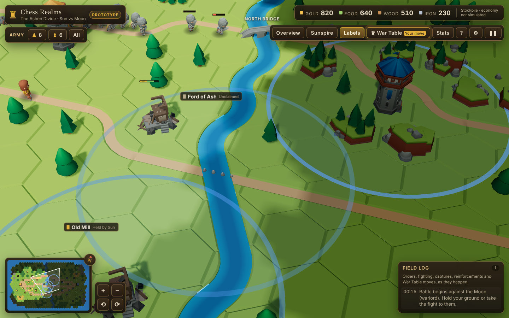
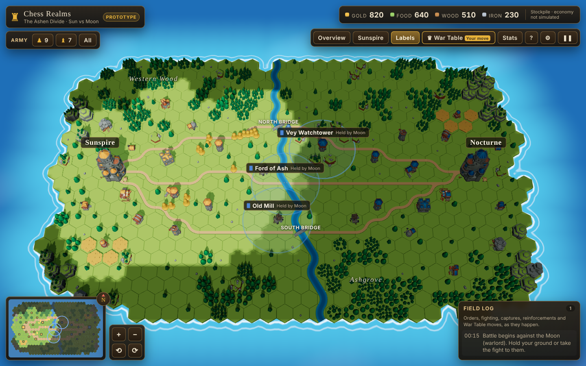

# Milestone 3 report: combat, health and enemy AI

**Goal (from the brief):** add combat, health, and an enemy AI.

## What was implemented

**Combat, in the deterministic simulation (`packages/game-core/src/sim/sim.ts`)**

- **Unit stats:**

  | Unit | Damage | Reach | Attack time | Sight |
  | --- | --- | --- | --- | --- |
  | Infantry | 12 | melee | 1.0 s | 6.5 |
  | Archers | 8 | 7 | 1.5 s | 8.5 |

  Both have 100 health.
- **Real hits.**
  - Melee blows land 0.4 s into the swing.
  - Arrows fly at 14 units/s and land on the target's position at impact.
  - Both are queued in the sim, so they are deterministic and replayable.
  - A blow is cancelled if its attacker dies first, so there are no hits from beyond the grave.
- **Orders:**
  - Attack a soldier or building (right-click an enemy).
  - Attack-move (T, then right-click; or the panel button): fight anything met on the way, then resume.
  - Plain move: march without stopping to fight.
  - Stop.
- **Behaviour when idle.**
  - Idle soldiers defend themselves: they pick the nearest visible enemy in sight.
  - Soldiers on a chase are leashed 9 units from where they started, so they can't be kited across the map.
- **Buildings fight back.**
  - Castles shoot: 10 damage, range 8, every 1.2 s.
  - Watchtowers shoot: 8 damage, range 7, every 1.5 s.
  - Castles take half damage.
  - Destroyed buildings turn into rubble on the map. The world rebuilds their tiles.
- **Death.** A dying soldier plays the death clip and lies for 4 s before being removed.
- **Reinforcements.**
  - Every 90 s: 2 infantry from each barracks and 1 archer from each archery range.
  - Capped at 40 soldiers per side.
  - Only while those buildings stand, so destroying them matters.
- **Capture points actually capture.**
  - Progress runs from -100 to 100. Each soldier in the ring adds 0.6 per tick, counting at most 3.
  - Only uncontested rings move.
  - Vey Watchtower gives the holder +2 sight.
- **Victory.** The match ends when a castle falls (or on War Table checkmate, milestone 5). Winners cheer; the field freezes.
- **Fog of war.**
  - Per side, per cell: visible / explored / unknown.
  - Updated every 0.5 s from soldiers' and buildings' sight.
  - Enemies are drawn and targetable only when visible.
  - The terrain shader darkens explored ground and blacks out the unknown; the minimap matches.
- **Stats** per side (kills, losses, buildings destroyed, captures, reinforcements) for the battle report.
- **`stateHash(sim)`**: an FNV-1a hash of everything that matters, used for desync checks in milestone 6.

**Moon AI (`packages/game-core/src/ai/commander.ts`)**

- **A commander with three phases:**
  - **muster:** gather at the rally point east of the river while the patrol walks.
  - **attack:** take the Ford of Ash, then the Old Mill, then the Sunspire castle, using attack-moves.
  - **retreat:** fall back to the rally point when the army drops below a threshold, then muster again.
- **Defence:** if Sun soldiers come within 9 units of a Moon building, the closest Moon soldiers break off to defend it.
- **Difficulty:**

  | Level | Attacks after | Minimum army | Retreats below |
  | --- | --- | --- | --- |
  | Recruit | 3 min | 14 | 45% |
  | Captain | 2 min | 11 | 30% |
  | Warlord | 70 s | 9 | 20% |

- The AI issues ordinary commands, exactly like the player, so it cannot cheat on rules. It does read the whole map, ignoring fog (stated in RULES.md).

**On screen**

- Attack, hit, death and cheer clips, driven from sim timestamps, so they line up with the actual damage.
- Health bars appear over damaged or selected soldiers.
- Arrows are drawn in flight; attack markers are red.
- The unit panel shows the soldier's activity ("Fighting a Moon archer"), damage, kills and active buffs. The group roster flags who is fighting.
- Building panels show live health, weapon and capture progress.
- The field log reports skirmishes (aggregated per area, not one line per hit), captures, buildings destroyed and reinforcements.

## What is functional

- Everything above runs in the real build, driven by the simulation, with mouse, keyboard and touch.
- A full match plays out end to end against the AI: in a 1,150-tick Warlord check, kills were even (Sun 13, Moon 14), and the Moon took 2 points and destroyed 3 buildings.

## What remains mocked or incomplete

| Item | Status |
| --- | --- |
| Economy | Resource readouts are static, labelled "Stockpile · economy not simulated". No gathering, training or building. Reinforcements are free waves instead. |
| Unit types | Only infantry and archers. Cavalry, siege, scouts and commanders are not in. |
| Formations in combat | Soldiers fight individually; no shield walls or flanking bonuses. |
| AI and fog | The commander ignores fog. |
| Hit reactions | The hit clip plays, but there is no knockback or stagger. |

## Tests executed

**Unit tests:** 12 new in `packages/game-core/test/combat.test.ts`.

- A melee duel resolves with the right damage per blow and one death.
- Archers hit from range and never close to melee.
- Siege: soldiers destroy a tower; the castle falls and declares the winner.
- Attack-move fights on the way; a plain move does not stop to fight.
- Towers shoot intruders.
- Capture fills only while uncontested.
- Fog hides the enemy until they come into sight.
- Volley and rally effects change the damage numbers exactly.
- Reinforcement waves arrive and respect the cap.
- The commander crosses the river and attacks, the same way every run (deterministic).
- The commander defends its buildings.

**Browser test** (new): right-clicking an enemy soldier logs an attack order, and the enemy's health actually drops.

**Bugs found and fixed:**

- Both duellists died on the same tick (a blow from a dead attacker): pending blows now cancel.
- The plain-move test was passing for the wrong reason (it checked after arrival, when self-defence had kicked in). It now checks health at the moment of arrival.
- A tower in range polluted the duel test; that test now runs on an empty field.

## Performance

- **Simulation**, the full match (combat, AI, War Table search, fog) for 600 ticks in the browser:
  - 0.27 ms mean per tick
  - 3.7 ms at the 99th percentile
  - 6.6 ms worst case
  - The budget is 100 ms per tick.
- **Fog.** The fog update runs every 5 ticks and costs one small texture upload.
- **Rendering.** Draw calls and triangles are unchanged from milestone 2; see milestone 4 for the current table. Health bars and arrows are instanced (one draw each).

## Recommended next step

Milestone 4 (done in the same pass): menus and match flow around the battle.
