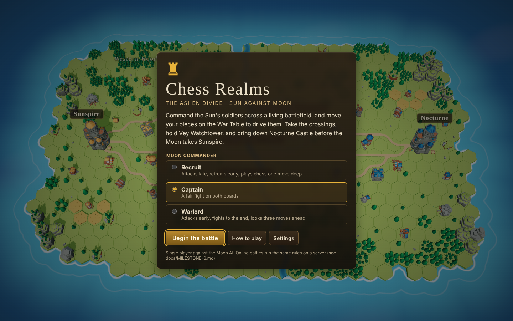
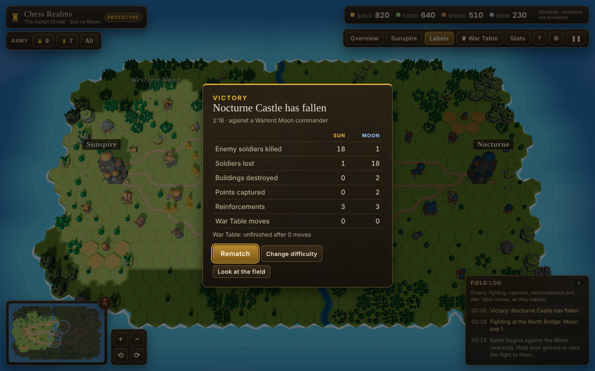

# Milestone 4 report: the game around the battle

**Goal (from the brief):** integrate the 3D battlefield with the existing UI: menus, HUD and match flow.

## What was implemented

**Match flow (`apps/web/src/hud/Menus.tsx`, `apps/web/src/state/ui.ts`)**

- **Title screen** over the live battlefield:
  - choose a difficulty (Recruit, Captain, Warlord, each with a one-line description)
  - "Begin the battle"
  - opened with `?server=…`, the button becomes "Join the online battle" (milestone 6)
- **Pause menu** (P, Esc or the ❚❚ button):
  - Resume
  - How to play
  - Settings
  - Restart the battle
  - Quit to title
  - The simulation really stops while paused (tested).
- **Battle report** when the battle ends:
  - victory or defeat, the reason and the duration
  - per-side kills, losses, buildings destroyed, points captured, reinforcements and War Table moves, plus the War Table result
  - Rematch, Change difficulty, or "Look at the field" (closes the report but keeps a button to reopen it)
  - It appears 3.5 s after the end, so the final blow and the cheering are seen first.
- **Settings:**
  - graphics quality (moved here from the toolbar)
  - always-on labels
  - edge panning
- **Starting a battle** builds a fresh `Match` (sim, commander, War Table) and resets the camera, log and selection. Rematch does the same.

**HUD integration**

- The HUD is hidden on the title screen. All input is ignored on the title screen and while paused.
- **Toolbar:** Overview, Sunspire, Labels, War Table (with a "Your move" nudge when the board waits for you), Stats, Help, Settings, Pause.
- **Attack-move:** T or the unit panel button, with an attack cursor. Esc backs out in order: help, then settings, then attack mode, then selection, then pause.
- **Live readouts.** Panels, overlays and the minimap now read the simulation:
  - building health and destroyed state
  - capture rings that change colour and pulse while contested, with live %
  - fog on the minimap, with only visible enemies shown (red)
- The brand chip says "Prototype". The help sheet lists every control, including the new ones.
- **Locked placeholders removed:** Attack (M3) and the War Table (M5) both work now.

## What is functional

All of the above, in the real build, on desktop and touch. A complete loop works: title, battle, victory or defeat, report, rematch or a new difficulty.

## What remains mocked or incomplete

| Item | Status |
| --- | --- |
| Resources | Static readouts, labelled "economy not simulated". |
| Audio | None. No music or sound effects. |
| Saving | Nothing persists: settings reset and a battle in progress is lost on reload. |
| Campaign or map choice | One map (the Ashen Divide). The title screen has no map picker. |
| Key rebinding, accessibility options beyond labels | Not built. |

## Tests executed

**Browser tests: `npx playwright test`, 15 passed, 0 failed (up from 10).** That count includes the online test from milestone 6.

- Every test now starts from the title screen (`__crStart`), as a player would.
- Updated:
  - quality is switched through Settings
  - the log text now reads "Battle begins"
  - a march may log as "marching" or "advancing"
- New (milestones 3 to 5):

  | Test | What it checks |
  | --- | --- |
  | War Table by click | Click e2, then e4 (a legal target). The log shows the Advance effect, the Moon thinks and replies, and the board returns to "Your move". |
  | Attack an enemy | Right-click an enemy soldier: the order is logged and its health drops. |
  | Pause | The pause dialog appears, the sim tick stops advancing, and Resume closes it. |
  | Victory | The battle report appears with "Victory"; Rematch starts a fresh battle. |

- Phone (touch, 390×844): tap a company, tap the map, and all 6 archers march. Still passes.

**Unit tests:** 76 passed across 12 files (up from 47).

**Typecheck:** clean across every package.

## Performance

Measured with `tools/perf-matrix.mjs` at 1440×900 in software WebGL, mid-battle, with 31 soldiers, fog on, health bars and arrows. Frame rate is not measurable without a GPU.

| Quality | View | Draw calls | Triangles | Change vs milestone 2 |
| --- | --- | --- | --- | --- |
| High | Full map (tokens) | 91 | 382k | about the same (now inside the 400k budget) |
| High | Close on Sun army | 48 | 319k | same |
| High | Mid zoom, both armies | 74 | 383k | down from 418k (now inside budget) |
| Medium | Close on Sunspire | 16 | 100k | same |
| Medium | Close on Sun army | 21 | 159k | same (6% over) |
| Medium | Mid zoom, both armies | 47 | 194k | down from 229k (fog hides enemy soldiers) |
| Medium | Full map | 62 | 184k | down from 190k |
| Low | Any | Same as Medium | — | Low saves on resolution and antialiasing, not draw calls |

- **Simulation:** 0.27 ms mean per tick, 6.6 ms worst case, budget 100 ms.
- **JavaScript heap:** 57–73 MB.
- **Bundle:** 1.38 MB of JavaScript, up about 80 KB (War Table, chess AI, menus, networking).

**Still not measured on a real phone.** Please open the preview on a phone with Stats on and send the fps.

## Recommended next step

Milestone 5 (done in the same pass): connect the War Table to the battlefield.
