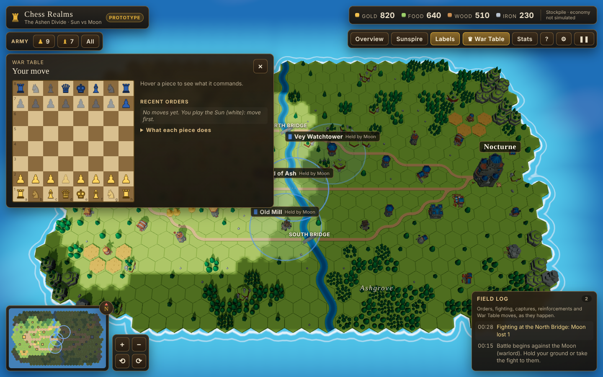

# Milestone 5 report: the War Table commands the battlefield

**Goal (from the brief):** link chess actions to battlefield effects through documented rules, keeping standard chess intact and custom rules separate.

The rules are written out for players in **[RULES.md](RULES.md)**. This report covers how they were built and tested.

## What was implemented

**Standard chess stays standard (`packages/chess-core`)**

- All legality comes from chess.js 1.4.0, unchanged. `StandardGame` only adds read helpers: `verboseMoves(from)` for legal targets and `pieceAt(sq)`.
- A test plays full games through the bonds layer and checks that the board, the legal moves and the outcome are identical to chess.js on its own.

**The bonds layer (`packages/chess-core/src/bonds.ts`), separate from the rules**

- **Piece identities.** Each piece gets a stable identity (`w-p-e`, `w-r-h`, `b-q`…) and follows it through castling, en passant and promotion.
- **Bindings:**
  - each pawn → one infantry soldier
  - each bishop → three archers
  - each rook → a watchtower
  - king → the castle
  - queen → the whole army
  - knights → no one (no cavalry yet)
- **Effects.** `apply(move, liveness)` returns plain effect descriptions: advance, volley, bombard, rally, fortify, break. It knows nothing about the simulation.
- **Leaderless pieces.** A piece whose soldiers or building are gone still moves but triggers nothing.

**Connecting chess to the battle (`packages/match`)**

- **`WarTable`** turns bond effects into ordinary simulation commands (`effect`), with every number in `BOND_RULES`:
  - advance 3 units
  - volley ×2 fire rate for 12 s
  - bombard ×2 tower damage for 15 s
  - rally +15% damage to the whole army for 15 s
  - fortify +120 castle health
  - break: half damage and +20% damage taken for 25 s
- **Turn-based** inside the real-time battle:
  - the board waits for the side to move
  - out-of-turn and illegal moves are refused with a reason
  - checkmate calls `declareWinner` and ends the battle
  - a draw closes the board
- **Moon War Table AI (`chessAi.ts`):**
  - an alpha-beta search (depth 1, 2 or 3 by difficulty) using chess.js move and undo
  - small bonuses for moves whose bonds help the battle, such as volleying with live archers
  - runs as a generator in slices of 25 nodes per tick, so a deep search never stalls a frame
  - replies after the difficulty's thinking delay
- **`Match`** is one object that owns a battle: sim, commander, patrol and War Table. It is used unchanged by the browser, the tests and the server.

**On screen (`apps/web/src/hud/WarTable.tsx`)**

- **The board** (B or the toolbar):
  - click a piece to see its legal targets, then click a target
  - pawns always promote to a queen
  - Moon pieces are blue, Sun pieces gold
  - leaderless pieces are faded
- **Hover a piece** to see what it commands ("Commands the whole army", "Leaderless: its regiment has fallen").
- **Recent orders** with their battlefield effect in words ("Volley: … shoot twice as fast for 12 s").
- A collapsible legend of what each piece does.
- **The Moon's thinking countdown.**
- **Toolbar nudge:** "Your move" when the board is waiting for you.
- **Effects are visible on the field:**
  - an advancing soldier marches
  - the unit panel lists the move behind each active buff (for example "Bc4 (Sun f-bishop)")
  - a fortified castle's health bar rises
  - every War Table move is logged in the field log

## What is functional

All of it, in the real build. You can play a whole chess game against the Moon while the battle runs, and each move changes the fight.

## What remains mocked or incomplete

| Item | Status |
| --- | --- |
| Knights | Command no one until cavalry exists. Their moves are legal but have no battlefield effect, and the board says so. |
| Promotion choice | The board UI always promotes to a queen. The rules layer and the server accept any piece. |
| Reinforcements | Not bound to pieces. Once a pawn's soldier dies, that pawn stays leaderless. |
| Balance | The effect sizes are first guesses. They haven't been tuned through playtesting. |
| Clock | No chess clock. The board waits as long as you like. |

## Tests executed

**Bonds (`packages/chess-core/test/bonds.test.ts`, 6 tests):**

- Each piece type maps to its documented effect.
- A castling rook keeps its tower and bombards.
- Capture breaks the captured piece's regiment, including en passant.
- A promoted pawn stays bound and acts as a queen.
- Pieces go leaderless when their soldiers fall or their tower is destroyed.
- The bonds never change what is legal, through a full game.

**Match (`packages/match/test/match.test.ts`, 6 tests):**

- A pawn move really moves its soldier on the battlefield.
- Turns and legality are enforced, and the Moon replies after its thinking time.
- A bishop move doubles its archers' fire rate for exactly the documented time.
- Checkmate on the War Table wins the battle.
- Leaderless pieces trigger nothing.
- A full match with both AIs is deterministic.

**Browser:** click e2 then e4, see the Advance effect in the log, and the Moon replies.

**Bug found and fixed:** at depth 3 the chess AI took 2.1 s in one go and froze the game. It now uses chess.js move and undo, a cheaper mate check, and generator slicing. The worst slice is about 27 ms, during warm-up.

## Performance

- **The chess AI** runs 25 search nodes per tick, at most about 30,000 nodes per move. Its time is included in the 0.27 ms mean per tick reported in milestone 3.
- **Board rendering:** the War Table is plain HTML and CSS, with no WebGL cost. It re-renders only when its state changes.

## Recommended next step

Milestone 6 (done in the same pass): an authoritative server, so this can be played online.
